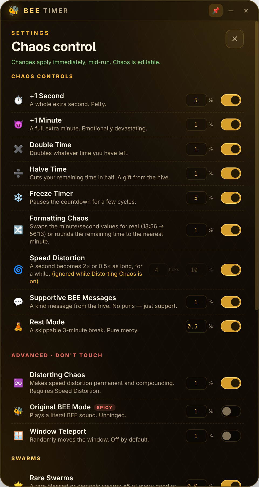
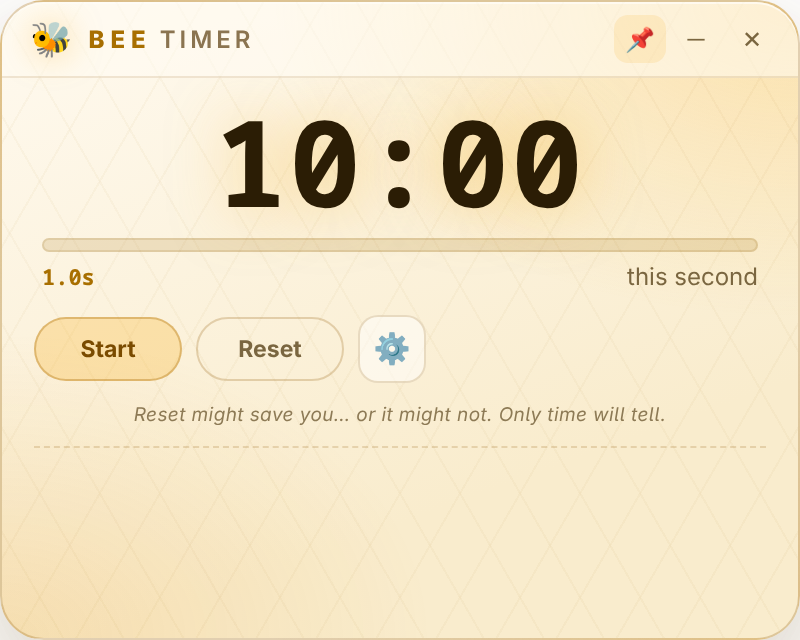
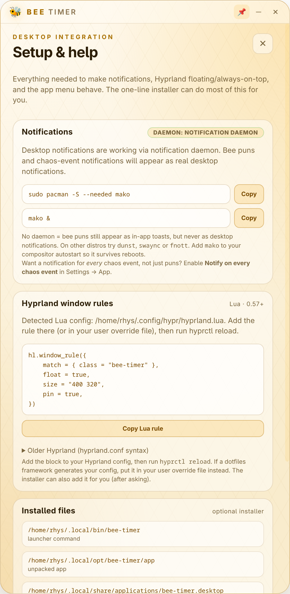
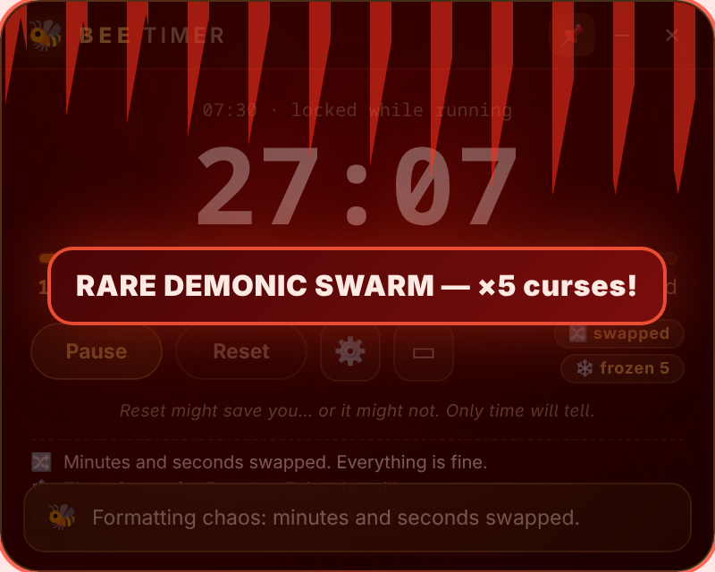
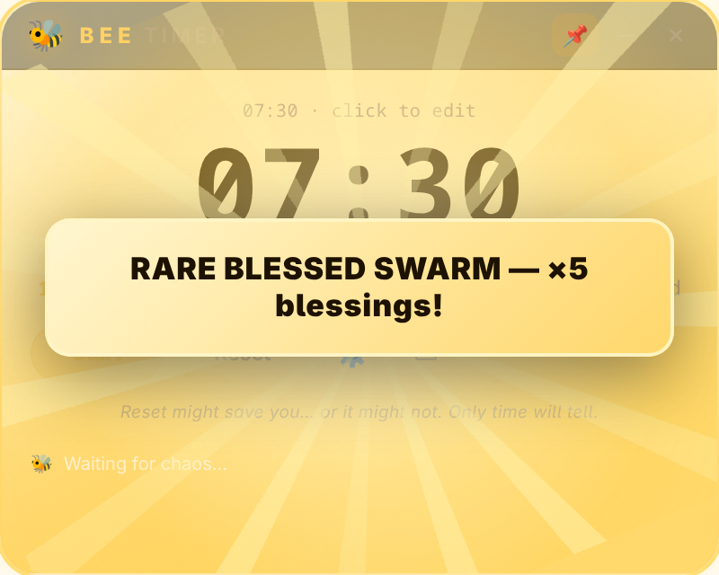

# 🐝 BEE Timer

**A floating, always-on-top study/work timer that refuses to let you stop early.** Start a focus block and the timer fights back — extra seconds, extra minutes, doubled time, halved time, freezes, scrambled formatting, warped tick speeds, supportive bee messages, and a literal buzzing bee. Perfect for beating procrastination by making the finish line wonderfully unreliable.

A bee-themed love letter to [DougDoug's chaotic countdown timer](https://youtu.be/FTUdUAfcsfY).

[](LICENSE)
[](#install)
[](https://www.electronjs.org/)

<p align="center">
  <a href="#install"><strong>Skip to install ↓</strong></a>
  &nbsp;·&nbsp; <a href="#linux">Linux</a>
  &nbsp;·&nbsp; <a href="#windows">Windows</a>
  &nbsp;·&nbsp; <a href="#macos">macOS</a>
  &nbsp;·&nbsp; <a href="#build-from-source">Build from source</a>
</p>

Set a study or work block — 10 minutes by default, or 25/50 minutes for a proper pomodoro-style session — and hit Start. The timer then does its best to keep you going: it adds seconds, adds minutes, doubles (or halves) what's left, freezes, scrambles the display, warps how long a second lasts, sends supportive bee messages, and occasionally buzzes at you. You can't trust the clock, so the only sensible move is to keep working until the bees finally relent.

<p align="center">
  
</p>

## Why it works as a study / work timer

Procrastination thrives on the exit door being one glance away. BEE Timer makes that door move.

- **It removes the "just quit now" option.** The countdown can grow, freeze, or double, so stopping early feels like losing to a bee. You stay in the chair.
- **Sessions naturally run longer.** +1s, +1m and Double Time events stretch a short block into a longer one. Set 25 or 50 minutes and let it overrun — that's the feature, not a bug.
- **Breaks instead of quitting.** Rest Mode pauses the clock for a skippable 3-minute break, so you can recover without abandoning the session.
- **Less clock-watching.** Formatting Chaos swaps minutes/seconds and rounds the display, breaking the habit of staring at the timer instead of the task.
- **Encouragement instead of nagging.** Supportive BEE messages drop in with a kind nudge exactly when you need one — a cheerleader, not a guilt trip. The chaos log and the occasional swarm keep the session playful enough that you don't negotiate your way out of it.

It's not productivity magic — it's a timer that turns "one more minute" from a guilty excuse into the actual rules of the game. Use it for studying, focused work, writing, revision, or a stream challenge; the duration and every effect are yours to tune.

## Features

Every feature is independently toggleable and has a per-tick probability you can edit in the app or in [`config.json`](docs/CONFIG.md). The default look is dark honey; **Light mode** in *Settings → App* switches to a cream-and-honey theme.

| Feature | Odds / tick | Default | What it does |
| --- | --- | --- | --- |
| ⏱️ +1 Second | 5% | **On** | Adds a second. Petty. |
| 😈 +1 Minute | 1% | **On** | Adds 60 seconds. Emotionally devastating. |
| ✖️ Double Time | 1% | **On** | Doubles remaining time (capped at 24h). |
| ➗ Halve Time | 1% | **On** | Cuts remaining time in half — a welcome mercy. |
| ❄️ Freeze Timer | 5% | **On** | Pauses the countdown for 5 cycles. |
| 🔀 Formatting Chaos | 5% | **On** | Swaps the two biggest units (hours↔minutes, or minutes↔seconds) or rounds the display. Sticky until reset; display only, never corrupts the real clock. |
| 🌀 Speed Distortion | 10% | **On** | A tick becomes 0.5× or 2× as long, for a configurable number of ticks (default 4). |
| ♾️ Distorting Chaos | 1% | **On** | Makes speed distortion permanent and compounding (2× → 4× → 8×, or back down with 0.5×). Requires Speed Distortion; while on, its own chance replaces Speed Distortion's chance/duration. |
| 💬 Supportive BEE Messages | 1% | **On** | A kind, encouraging message from the hive (no puns). Desktop notification plus in-app toast. |
| 🧘 Rest Mode | 0.5% | **On** | Gives you a 3-minute break (skippable) with a 5-minute cooldown. |
| 🌟 Rare Swarms | 0.05% | **On** | A rare **blessed** or **demonic** swarm: ×5 of every good or bad effect. Full-screen themed event. |
| 🐝 Common Swarms | 0.1% | **On** | A **happy** or **angry** swarm: ×1 of every good or bad effect, themed popup. |
| 🐝 Original BEE Mode | 1% | Off | Synthesized bee buzz + a swarm overlay. Unhinged. |
| 🪟 Window Teleport | 1% | Off | Randomly moves the window. Tucked under **Advanced · danger zone**. |

Other touches: draggable frameless titlebar, pin/always-on-top button, pulse meter that visualizes the current tick length, a rolling chaos log, editable settings mid-run (on by default), reduced-motion mode, a **light mode** (cream-and-honey, under *Settings → App*), an optional **notify on every chaos event** switch that turns each +1s, +1m, double, freeze, formatting, speed, teleport, rest, bee-mode, and end-of-timer event into a desktop notification, and a victory screen with run stats.

<p>
  
  
</p>
<p>
  
  
</p>
<p>
  
  
</p>
<p>
  
  
  
</p>

## Install

<p><strong>Jump to:</strong>
<a href="#linux">Linux</a> ·
<a href="#windows">Windows</a> ·
<a href="#macos">macOS</a> ·
<a href="#build-from-source">Build from source</a>
</p>

<a id="linux"></a>
### One-line install (Linux, optional)

No AUR account, no build tools, and no sudo for the app itself. Installs the latest release AppImage **extracted** into `~/.local/opt/bee-timer/` (so FUSE 2 is not required), adds a `bee-timer` command, and registers **BEE Timer** in your application menu:

```bash
# one-liner: latest release (prompts when a terminal is attached)
curl -fsSL https://raw.githubusercontent.com/nu-code-dev/bee-timer/main/install.sh | bash

# or from a checkout of the repo
bash install.sh

# unattended: accept the optional mako + Hyprland prompts (no prompts without a TTY)
curl -fsSL https://raw.githubusercontent.com/nu-code-dev/bee-timer/main/install.sh | BEE_TIMER_YES=1 bash
```

- x86_64 Linux, fully user-local (nothing outside `~/.local`)
- optional interactive prompts, defaulting to **No** (and reading from `/dev/tty`, so `curl | bash` still works): install `mako` on Arch when no notification daemon is running (other distros get package-manager advice), and append BEE Timer window rules to your Hyprland config (Lua `hyprland.lua` when present, legacy `hyprland.conf` otherwise). The rule edit backs the file up, skips duplicate rules, and runs `hyprctl reload` when available.
- unattended installs: `BEE_TIMER_YES=1` accepts both prompts; with no TTY the answers stay No
- uninstall with: `curl -fsSL https://raw.githubusercontent.com/nu-code-dev/bee-timer/main/install.sh | bash -s -- --uninstall` — this also removes the BEE Timer rule block the installer added to your Hyprland config, leaving the rest of the file and your app config untouched
- `BEE_TIMER_PREFIX=/usr/local` with `sudo` for a system-wide install, `BEE_TIMER_VERSION=0.1.5` to pin a release
- completely optional — the AUR package, AppImage, `.deb`, and source builds below all still work
- the same setup notes (notification-daemon status, copyable Hyprland snippets, installed paths, uninstall command) are inside the app under **Settings → Setup & integration**


### Arch Linux

> **AUR status: not published — account registration is currently blocked.** The `bee-timer-bin` package is submission-ready in [`packaging/arch/`](packaging/arch/) (PKGBUILD + `.SRCINFO` + real checksum + desktop entry + icon), but new AUR account registration is currently unavailable, so it cannot be submitted yet. When registration reopens, the prepared package can be published as-is. Until then, use the one-line installer above, the AppImage/`.deb`, or build it locally:

```bash
git clone https://github.com/nu-code-dev/bee-timer.git
cd bee-timer/packaging/arch
makepkg -si
```

That installs the release AppImage to `/opt/bee-timer/` behind a `/usr/bin/bee-timer` wrapper, plus a desktop entry and icon. Once the package is on the AUR, `yay -S bee-timer-bin` / `paru -S bee-timer-bin` will work as usual. If the AppImage will not start, install FUSE 2: `sudo pacman -S fuse2`.

### Direct download (Linux)

Grab `bee-timer-0.1.5-x86_64.AppImage` or `bee-timer-0.1.5-amd64.deb` from [Releases](https://github.com/nu-code-dev/bee-timer/releases) (tag `v0.1.5`):

```bash
# AppImage
chmod +x bee-timer-0.1.5-x86_64.AppImage
./bee-timer-0.1.5-x86_64.AppImage

# Debian / Ubuntu
sudo apt install ./bee-timer-0.1.5-amd64.deb
```

<a id="windows"></a>
### Windows

Download the [`bee-timer-0.1.5-x64.exe`](https://github.com/nu-code-dev/bee-timer/releases/tag/v0.1.3) NSIS installer from [Releases](https://github.com/nu-code-dev/bee-timer/releases). It is built by GitHub Actions on every release and is **unsigned**:

- SmartScreen will show *"Windows protected your PC"* → click **More info** → **Run anyway**.
- Windows builds are **x64 only** and are CI-produced; they are not smoke-tested on real Windows hardware by the maintainer yet.

<a id="macos"></a>
### macOS

Download the [`bee-timer-0.1.5-arm64.dmg`](https://github.com/nu-code-dev/bee-timer/releases/tag/v0.1.3) disk image from [Releases](https://github.com/nu-code-dev/bee-timer/releases). It is **Apple Silicon only** (the CI runner is `macos-latest`/arm64), unsigned and not notarized:

- Gatekeeper will block the app → right-click the app → **Open**, or allow it under **System Settings → Privacy & Security**.
- Intel Macs would need a separate build (not configured in CI yet); building from source below also works.
- There is no auto-updater; upgrade by downloading the next release.

## Hyprland quickstart

BEE Timer runs as an **XWayland** client on Linux by default when `$DISPLAY` is set, because Wayland has no always-on-top toplevel protocol while Hyprland honors `_NET_WM_STATE_ABOVE` for XWayland windows. Force native Wayland with `BEE_TIMER_OZONE=wayland` (always-on-top then depends on your compositor rules).

Hyprland tiles new windows, so add rules. Current Hyprland (0.57+) uses a **Lua config** — the main file is usually `~/.config/hypr/hyprland.lua`, often split into modules via `require()`. Put this in the main file or a rules module it requires:

```lua
hl.window_rule({
    match = { class = "bee-timer" },
    float = true,
    size = "400 320",
    pin = true,
})
```

Then run `hyprctl reload` and restart BEE Timer — rules apply when the window opens. Runtime `hyprctl keyword windowrulev2 …` (and `hyprctl keyword windowrule …`) returned *unknown request* on Hyprland 0.57 — the rules must be **edited in a config file**, not added with `hyprctl keyword`. If your config is generated by a dotfiles/framework setup (Caelestia, KooL dots, and friends), add the block to your **user-overrides file** instead of the generated main config, or it may be overwritten.

Older Hyprland setups use `hyprland.conf` syntax; keep this as the legacy fallback:

```ini
# Hyprland ≤ 0.52 (windowrulev2 syntax)
windowrulev2 = float,class:^(bee-timer)$
windowrulev2 = size 400 320,class:^(bee-timer)$
windowrulev2 = pin,class:^(bee-timer)$

# Hyprland 0.53+ (new windowrule syntax; consult your version)
windowrule = float, class:^(bee-timer)$
windowrule = size 400 320, class:^(bee-timer)$
windowrule = pin, class:^(bee-timer)$
```

The one-line installer offers to add these rules for you when it detects Hyprland (Lua first, `.conf` fallback; it backs up the file, skips duplicates, and reloads), or prints the snippet if you decline. Either way, the snippet is also copyable in-app under **Settings → Setup & integration**, and ships as [`packaging/arch/hyprland.conf.snippet`](packaging/arch/hyprland.conf.snippet).

Check `hyprctl clients` to confirm the window class is `bee-timer`. Notifications need a `notify-send`-compatible daemon (`mako`, `dunst`, `swaync`, `fnott`, …): on Arch `sudo pacman -S mako`, then start it with `mako &` or add it to your compositor autostart. Without a daemon, supportive messages and chaos-event notifications fall back to in-app toasts; **Settings → Setup & integration** shows the detected daemon status. Audio is synthesized via WebAudio and needs PipeWire or PulseAudio. Full guide, positioning tips, and troubleshooting: [docs/HYPRLAND.md](docs/HYPRLAND.md).

## Controls

| Action | How |
| --- | --- |
| Move the widget | Drag the titlebar (frameless window). |
| Pause / start / stop | **Space** while the timer screen is focused, or the Pause/Start button. While paused, **Reset becomes Stop** (returns to the starting duration without restarting). |
| Pin on top | 📌 button in the titlebar, or *Always on top* in settings. |
| Settings | ⚙️ on the widget (works mid-run by default). |
| Setup & integration | ⚙️ Settings → **Setup & integration**: notification-daemon status, copyable Hyprland rule snippets, installed paths, uninstall command. |
| Light mode | ⚙️ Settings → **App** → *Light mode* toggles the cream-and-honey theme (default is dark honey). |
| Notify on every chaos event | ⚙️ Settings → **App**: also send each chaos event as a desktop notification (needs a notification daemon). |
| Skip a rest | **Skip rest** button on the rest overlay. |
| Change start duration | Click the `10:00 · click to edit` label above the countdown — only available before the timer starts (not while running or paused). |
| Compact mode | ▭ button next to ⚙️ — window collapses to just the countdown; bee messages and swarm themes still appear. Exit with ⤢ or Esc. |
| Reset / run again | **Reset** on the widget, or **Run it back** on the end screen. |
| Quit / minimize | ✕ / ─ in the titlebar, or *Quit BEE Timer* in settings. |

The timer is **not resumed on relaunch** — run state isn't persisted. A fresh launch shows the full duration, paused, waiting for you to hit Start.

## Configuration

Config is JSON, sanitized and clamped on load, and written atomically by the main process. It lives at:

| OS | Path |
| --- | --- |
| Linux | `~/.config/BEE Timer/config.json` |
| Windows | `%APPDATA%\BEE Timer\config.json` |
| macOS | `~/Library/Application Support/BEE Timer/config.json` |

The Settings screen is the friendly way to edit it — feature toggles, per-tick percentages, duration, always-on-top, mid-run editing, reduced motion, light mode, and the notify-on-every-event switch. For the full key-by-key schema, ranges, and examples, see [docs/CONFIG.md](docs/CONFIG.md).

## Build from source

Requires Node.js 24+ and npm. Electron 45 is pinned as a dev dependency.

```bash
npm install
npm start          # run the app in dev
npm test           # chaos-engine test suite (14 tests)
npm run icon       # regenerate build/icon.png (dependency-free script)
```

Electron's postinstall download can be blocked by newer npm `allowScripts` policies. If `node_modules/electron/dist/electron` is missing after `npm install`:

```bash
XDG_CACHE_HOME=$PWD/.cache node node_modules/electron/install.js
```

### Packaging

```bash
npm run dist:linux   # AppImage + .deb into dist/
npm run dist:dir     # unpacked directory build (smoke test)
npm run dist:win     # Windows installer — run on Windows or CI
npm run dist:mac     # macOS .dmg — run on macOS or CI
```

Linux artifact names are pinned by `build.artifactName = "bee-timer-${version}-${arch}.${ext}"`: `dist/bee-timer-0.1.5-x86_64.AppImage` (AppImage) and `dist/bee-timer-0.1.5-amd64.deb` (Debian package). Cross-platform builds are out of scope locally — the [release workflow](.github/workflows/release.yml) builds each OS on its own runner and attaches the artifacts to a GitHub Release.

## Testing

`npm test` runs Node's built-in test runner against `test/engine.test.mjs`. The engine takes injectable `rng`, `schedule`, and `now` functions, so every chaotic effect is deterministic: the suite covers formatting modes, tick counting, pause/resume, each effect, freeze/rest/cooldown semantics, the 24-hour cap, and a seeded 10,000-tick statistical check of the 1% minute odds. See [docs/ARCHITECTURE.md](docs/ARCHITECTURE.md) for the design.

## Project structure

```
src/
  main/       Electron main process: window management, IPC, config persistence
  renderer/   Vanilla ES modules UI (no bundler)
    engine.js       Chaos engine — pure, injectable, testable
    features.js     Feature metadata (labels, order, advanced flag)
    app.js          UI wiring, audio synthesis, effects
    index.html      Screens: wizard, timer widget, settings
    styles.css      Honey-themed frameless widget styling
    puns.js         ~60 supportive bee messages (legacy filename)
  main/preload.js   contextBridge API (window.bee)
test/          Node test runner suite for the engine
build/         icon.png (generated by scripts/make-icon.js)
docs/          Screenshots, Hyprland/config/architecture docs
packaging/     arch/ PKGBUILD, desktop entry, Hyprland snippet
.github/       CI and tagged-release workflows
```

## Roadmap

- **Tauri port** for dramatically smaller binaries and lower memory use.
- **Native Wayland overlay** via `gtk-layer-shell` (true always-on-top without XWayland).
- **OBS browser source** so streamers can capture the timer directly.
- **Tray icon** and run-state recovery (resume a countdown after relaunch).
- **Auto-updater** with signed release feeds.
- **Code signing / notarization** for Windows and macOS.
- **Flatpak** and an AUR source package (`bee-timer`) alongside the submission-ready binary package (`bee-timer-bin`, see [`packaging/arch/`](packaging/arch/)).

## Acknowledgements

- Inspired by **DougDoug's** gloriously cursed countdown timer: [youtu.be/FTUdUAfcsfY](https://youtu.be/FTUdUAfcsfY). Go watch it; it's the reason this exists.
- Built with [Electron](https://www.electronjs.org/). All sounds are synthesized at runtime with the WebAudio API, so there are no third-party audio assets to license.
- Thanks to the Hyprland project for XWayland support that makes always-on-top possible.

## License

[MIT](LICENSE) © 2026 nu-code-dev. Do whatever you want, just don't blame the bees.
