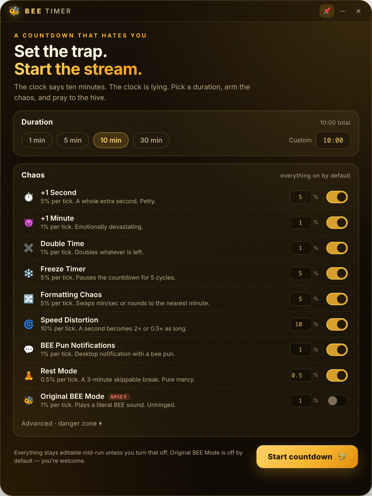
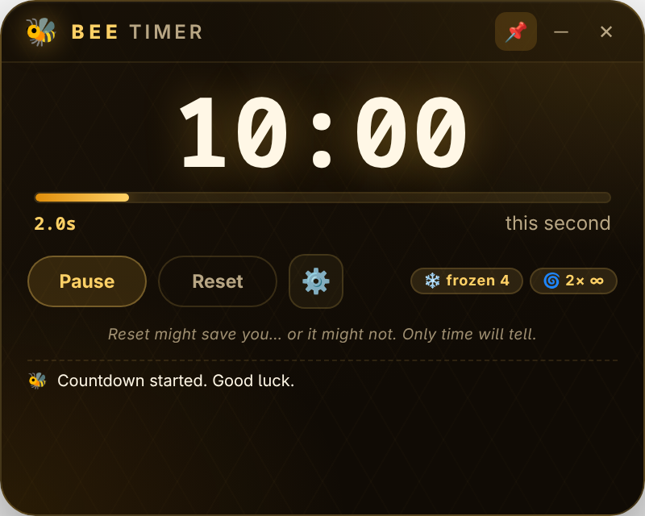
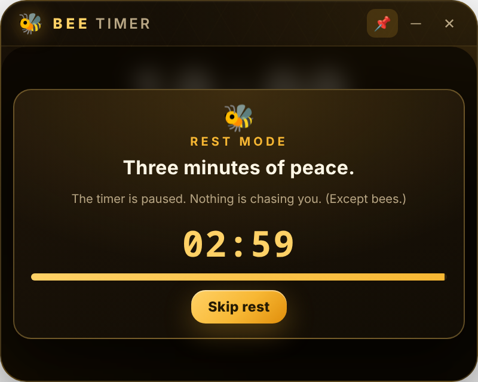
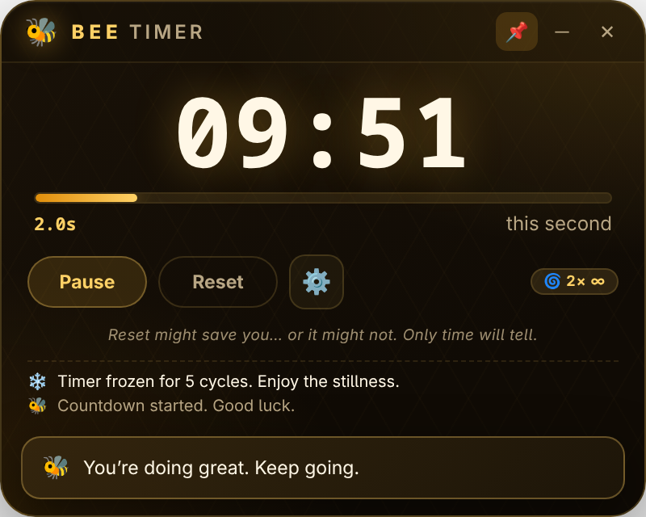

# 🐝 BEE Timer

**A floating, always-on-top study/work timer that refuses to let you stop early.** Start a focus block and the timer fights back — extra seconds, extra minutes, doubled time, freezes, scrambled formatting, warped tick speeds, bee puns, and a literal buzzing bee. Perfect for beating procrastination by making the finish line wonderfully unreliable.

A bee-themed love letter to [DougDoug's chaotic countdown timer](https://youtu.be/FTUdUAfcsfY).

[](LICENSE)
[](#install)
[](https://www.electronjs.org/)

Set a study or work block — 10 minutes by default, or 25/50 minutes for a proper pomodoro-style session — and hit Start. The timer then does its best to keep you going: it adds seconds, adds minutes, doubles what's left, freezes, scrambles the display, warps how long a second lasts, fires bee puns, and occasionally buzzes at you. You can't trust the clock, so the only sensible move is to keep working until the bees finally relent.

<p align="center">
  
</p>

## Why it works as a study / work timer

Procrastination thrives on the exit door being one glance away. BEE Timer makes that door move.

- **It removes the "just quit now" option.** The countdown can grow, freeze, or double, so stopping early feels like losing to a bee. You stay in the chair.
- **Sessions naturally run longer.** +1s, +1m and Double Time events stretch a short block into a longer one. Set 25 or 50 minutes and let it overrun — that's the feature, not a bug.
- **Breaks instead of quitting.** Rest Mode pauses the clock for a skippable 3-minute break, so you can recover without abandoning the session.
- **Less clock-watching.** Formatting Chaos swaps minutes/seconds and rounds the display, breaking the habit of staring at the timer instead of the task.
- **Momentum through nonsense.** Bee puns, the chaos log, and the occasional swarm keep the session playful enough that you don't negotiate your way out of it.

It's not productivity magic — it's a timer that turns "one more minute" from a guilty excuse into the actual rules of the game. Use it for studying, focused work, writing, revision, or a stream challenge; the duration and every effect are yours to tune.

## Features

Every feature is independently toggleable and has a per-tick probability you can edit in the app or in [`config.json`](docs/CONFIG.md).

| Feature | Odds / tick | Default | What it does |
| --- | --- | --- | --- |
| ⏱️ +1 Second | 5% | **On** | Adds a second. Petty. |
| 😈 +1 Minute | 1% | **On** | Adds 60 seconds. Emotionally devastating. |
| ✖️ Double Time | 1% | **On** | Doubles remaining time (capped at 24h). |
| ❄️ Freeze Timer | 5% | **On** | Pauses the countdown for 5 cycles. |
| 🔀 Formatting Chaos | 5% | **On** | Swaps min/sec or rounds the display — display only, never corrupts the real clock. |
| 🌀 Speed Distortion | 10% | **On** | A tick becomes 0.5× or 2× as long, for 4 ticks. |
| 💬 BEE Pun Notifications | 1% | **On** | Desktop notification with one of ~60 puns; falls back to an in-app toast. |
| 🧘 Rest Mode | 0.5% | **On** | Gives you a 3-minute break (skippable) with a 5-minute cooldown. |
| 🐝 Original BEE Mode | 1% | Off | Synthesized bee buzz + a swarm overlay. Unhinged. |
| 🪟 Window Teleport | 1% | Off | Randomly moves the window. Tucked under **Advanced · danger zone**. |

Other touches: draggable frameless titlebar, pin/always-on-top button, pulse meter that visualizes the current tick length, a rolling chaos log, editable settings mid-run (on by default), reduced-motion mode, and a victory screen with run stats.

<p>
  
  
</p>
<p>
  
  
</p>

## Install

### Arch Linux

> **AUR status: package prepared, not yet published.** The `bee-timer-bin` package is submission-ready in [`packaging/arch/`](packaging/arch/) (PKGBUILD + `.SRCINFO` + desktop entry + icon), but new AUR packages must be created from the maintainer's AUR account through the web interface, then pushed over SSH. Until it's published, build it locally:

```bash
git clone https://github.com/nu-code-dev/bee-timer.git
cd bee-timer/packaging/arch
makepkg -si
```

That installs the release AppImage to `/opt/bee-timer/` behind a `/usr/bin/bee-timer` wrapper, plus a desktop entry and icon. Once the package is on the AUR, `yay -S bee-timer-bin` / `paru -S bee-timer-bin` will work as usual. If the AppImage will not start, install FUSE 2: `sudo pacman -S fuse2`.

### Direct download (Linux)

Grab `bee-timer-0.1.0-x86_64.AppImage` or `bee-timer-0.1.0-amd64.deb` from [Releases](https://github.com/nu-code-dev/bee-timer/releases) (tag `v0.1.0`):

```bash
# AppImage
chmod +x bee-timer-0.1.0-x86_64.AppImage
./bee-timer-0.1.0-x86_64.AppImage

# Debian / Ubuntu
sudo apt install ./bee-timer-0.1.0-amd64.deb
```

### Windows and macOS

Windows (`NSIS` installer, `.exe`) and macOS (`.dmg`) builds are produced by GitHub Actions on every release — see [Releases](https://github.com/nu-code-dev/bee-timer/releases). They are **unsigned**:

- **Windows:** SmartScreen will show "Windows protected your PC" → *More info* → *Run anyway*.
- **macOS:** Gatekeeper will block the app → right-click the app → *Open*, or allow it under *System Settings → Privacy & Security*.

macOS builds are not notarized; there is no auto-updater. If you prefer, build from source below.

## Hyprland quickstart

BEE Timer runs as an **XWayland** client on Linux by default when `$DISPLAY` is set, because Wayland has no always-on-top toplevel protocol while Hyprland honors `_NET_WM_STATE_ABOVE` for XWayland windows. Force native Wayland with `BEE_TIMER_OZONE=wayland` (always-on-top then depends on your compositor rules).

Hyprland tiles new windows, so add rules. Good news: rules **must** go in `hyprland.conf` (runtime `hyprctl keyword windowrulev2 …` and `windowrule` both returned *unknown request* on Hyprland 0.57) — then run `hyprctl reload`.

```ini
# Hyprland ≤ 0.52 (windowrulev2 syntax)
windowrulev2 = float,class:^(bee-timer)$
windowrulev2 = size 400 320,class:^(bee-timer)$
windowrulev2 = pin,class:^(bee-timer)$
windowrulev2 = stayfocused,class:^(bee-timer)$

# Hyprland 0.53+ (new windowrule syntax; consult your version)
windowrule = float, class:^(bee-timer)$
windowrule = size 400 320, class:^(bee-timer)$
windowrule = pin, class:^(bee-timer)$
windowrule = stay_focused, class:^(bee-timer)$
```

Check `hyprctl version` for your syntax, and `hyprctl clients` to confirm the window class is `bee-timer`. Notifications need `mako`, `dunst`, or another `notify-send`-compatible daemon; audio is synthesized via WebAudio and needs PipeWire or PulseAudio. Full guide, positioning tips, and troubleshooting: [docs/HYPRLAND.md](docs/HYPRLAND.md).

## Controls

| Action | How |
| --- | --- |
| Move the widget | Drag the titlebar (frameless window). |
| Pause / start | **Space** while the timer screen is focused, or the Pause/Start button. |
| Pin on top | 📌 button in the titlebar, or *Always on top* in settings. |
| Settings | ⚙️ on the widget (works mid-run by default). |
| Skip a rest | **Skip rest** button on the rest overlay. |
| Reset / run again | **Reset** on the widget, or **Run it back** on the end screen. |
| Quit / minimize | ✕ / ─ in the titlebar, or *Quit BEE Timer* in settings. |

The timer is **not resumed on relaunch** — run state isn't persisted. A fresh launch shows the full duration, paused, waiting for you to hit Start.

## Configuration

Config is JSON, sanitized and clamped on load, and written atomically by the main process. It lives at:

| OS | Path |
| --- | --- |
| Linux | `~/.config/BEE Timer/config.json` |
| Windows | `%APPDATA%\BEE Timer\config.json` |
| macOS | `~/Library/Application Support/BEE Timer/config.json` |

The Settings screen is the friendly way to edit it — feature toggles, per-tick percentages, duration, always-on-top, mid-run editing, and reduced motion. For the full key-by-key schema, ranges, and examples, see [docs/CONFIG.md](docs/CONFIG.md).

## Build from source

Requires Node.js 24+ and npm. Electron 45 is pinned as a dev dependency.

```bash
npm install
npm start          # run the app in dev
npm test           # chaos-engine test suite (14 tests)
npm run icon       # regenerate build/icon.png (dependency-free script)
```

Electron's postinstall download can be blocked by newer npm `allowScripts` policies. If `node_modules/electron/dist/electron` is missing after `npm install`:

```bash
XDG_CACHE_HOME=$PWD/.cache node node_modules/electron/install.js
```

### Packaging

```bash
npm run dist:linux   # AppImage + .deb into dist/
npm run dist:dir     # unpacked directory build (smoke test)
npm run dist:win     # Windows installer — run on Windows or CI
npm run dist:mac     # macOS .dmg — run on macOS or CI
```

Linux artifact names are pinned by `build.artifactName = "bee-timer-${version}-${arch}.${ext}"`: `dist/bee-timer-0.1.0-x86_64.AppImage` (AppImage) and `dist/bee-timer-0.1.0-amd64.deb` (Debian package). Cross-platform builds are out of scope locally — the [release workflow](.github/workflows/release.yml) builds each OS on its own runner and attaches the artifacts to a GitHub Release.

## Testing

`npm test` runs Node's built-in test runner against `test/engine.test.mjs`. The engine takes injectable `rng`, `schedule`, and `now` functions, so every chaotic effect is deterministic: the suite covers formatting modes, tick counting, pause/resume, each effect, freeze/rest/cooldown semantics, the 24-hour cap, and a seeded 10,000-tick statistical check of the 1% minute odds. See [docs/ARCHITECTURE.md](docs/ARCHITECTURE.md) for the design.

## Project structure

```
src/
  main/       Electron main process: window management, IPC, config persistence
  renderer/   Vanilla ES modules UI (no bundler)
    engine.js       Chaos engine — pure, injectable, testable
    features.js     Feature metadata (labels, order, advanced flag)
    app.js          UI wiring, audio synthesis, effects
    index.html      Screens: wizard, timer widget, settings
    styles.css      Honey-themed frameless widget styling
    puns.js         ~60 bee puns
  main/preload.js   contextBridge API (window.bee)
test/          Node test runner suite for the engine
build/         icon.png (generated by scripts/make-icon.js)
docs/          Screenshots, Hyprland/config/architecture docs
packaging/     arch/ PKGBUILD, desktop entry, Hyprland snippet
.github/       CI and tagged-release workflows
```

## Roadmap

- **Tauri port** for dramatically smaller binaries and lower memory use.
- **Native Wayland overlay** via `gtk-layer-shell` (true always-on-top without XWayland).
- **OBS browser source** so streamers can capture the timer directly.
- **Tray icon** and run-state recovery (resume a countdown after relaunch).
- **Auto-updater** with signed release feeds.
- **Code signing / notarization** for Windows and macOS.
- **Flatpak** and an AUR source package (`bee-timer`) alongside the submission-ready binary package (`bee-timer-bin`, see [`packaging/arch/`](packaging/arch/)).

## Acknowledgements

- Inspired by **DougDoug's** gloriously cursed countdown timer: [youtu.be/FTUdUAfcsfY](https://youtu.be/FTUdUAfcsfY). Go watch it; it's the reason this exists.
- Built with [Electron](https://www.electronjs.org/). All sounds are synthesized at runtime with the WebAudio API, so there are no third-party audio assets to license.
- Thanks to the Hyprland project for XWayland support that makes always-on-top possible.

## License

[MIT](LICENSE) © 2026 nu-code-dev. Do whatever you want, just don't blame the bees.
